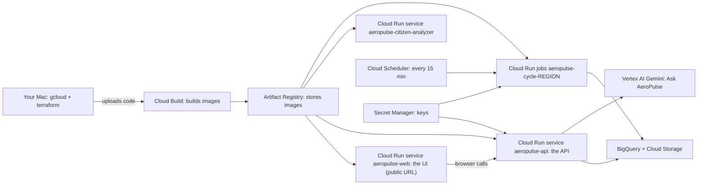

# Deploy AeroPulse to Google Cloud, step by step

This guide is for someone new to Google Cloud. It puts AeroPulse on the internet as a live website for the hackathon submission. **Cloud Build** builds the container images inside Google Cloud, so you don't need Docker on your laptop.

At the end you will have a public address like this. The random part and region code are assigned by Google:

```text
https://aeropulse-web-<random>-<region-code>.a.run.app
```

That is the URL you submit. Anyone can open it; no login is needed.

You run every command in this guide **on your Mac, from the repository root**:

```bash
cd ~/Documents/hackathon/AeroPulse/AI-Builder
```

---

## What you are building



| Google Cloud word | What it means here |
| --- | --- |
| **Project** | A container for everything below, with its own bill. You create one. |
| **Billing account** | The card or credits the project charges. Required even when usage stays small. |
| **Cloud Build** | Google's machines that run `docker build` for you. |
| **Artifact Registry** | Where the built images are stored. |
| **Cloud Run service** | Runs a container behind an HTTPS URL. It scales to zero when nobody visits. AeroPulse has three: web, API and citizen analyzer. |
| **Cloud Run job** | Runs a container to completion. AeroPulse runs one job per region, every 15 minutes, which fetches live data and writes a fresh snapshot. |
| **Cloud Scheduler** | The timer that starts those jobs. |
| **Secret Manager** | Holds API keys and the token-signing secret. Code reads them at runtime; they are never in files or images. |
| **BigQuery, Cloud Storage** | Where history, snapshots and citizen uploads live. |
| **Vertex AI** | Runs Gemini for Ask AeroPulse and the citizen photo observation. It uses the service's own identity, so there is no API key. |
| **Terraform** | A tool that creates all of the above from the files in `infrastructure/gcp/`. You run one command instead of clicking through the console. |

The repository already has everything this guide uses:

| File | Purpose |
| --- | --- |
| `infrastructure/gcp/*.tf` | Terraform: services, jobs, scheduler, storage, permissions, secrets |
| `infrastructure/gcp/cloudbuild/app.yaml` | Cloud Build recipe for the Python image (API, cycle jobs, citizen analyzer) |
| `infrastructure/gcp/cloudbuild/web.yaml` | Cloud Build recipe for the web image. It bakes in the API address and a read-only demo token |
| `.gcloudignore` | What gets uploaded to Cloud Build. Your `.env` files, local history (`aeropulse-data/`, `var/`), docs and tests stay on your Mac |

The trained models (`config/models/` and `config/model_serving.yaml`) travel inside the app image, so nothing needs training in the cloud.

---

## Part A — One-time account setup (in the browser)

### A1. Create a project

1. Open [console.cloud.google.com](https://console.cloud.google.com) and sign in with your Google account.
2. Use a **personal account** if you can. Company or school accounts often have organisation policies that block public websites ("domain restricted sharing"), and then the URL would not open for judges.
3. Click the project picker at the top, then **New project**. Give it a name, for example `aeropulse-hackathon`.
4. Note the **Project ID** shown under the name, for example `aeropulse-hackathon-123456`. Commands need the ID, not the display name.

### A2. Turn on billing

1. Open **Billing** in the left menu and link a billing account to the project. New accounts usually get free trial credit; hackathons often give credits too.
2. Open **Billing → Budgets & alerts → Create budget**. Set an amount you are comfortable with, and alerts at 50% and 90%. Google then emails you before you overspend.

### A3. Optional: register Earth Engine

The Sentinel-5P aerosol index comes from Earth Engine. Register the project once, for non-commercial use, at [code.earthengine.google.com/register](https://code.earthengine.google.com/register).

If you skip this, the `earthengine` source shows as not working on the **Data sources** page, and everything else still runs.

### A4. Get your two data keys ready

They are already in your local `infrastructure/docker/.env` (`AEROPULSE_OPENAQ_API_KEY` and `AEROPULSE_FIRMS_MAP_KEY`). Step 6 copies them straight from that file into Secret Manager, without printing them. Both must have a value, because Cloud Run will not start a job whose secret is empty.

### A5. Pick the Gemini model

Ask AeroPulse and the citizen photo analysis call Gemini on Vertex AI.
1. In the console, open **Vertex AI → Vertex AI Studio**. If asked, enable the API.
2. Choose a Gemini Flash model and send a test prompt.
3. Note the exact model name, for example the one you use locally as `AEROPULSE_GEMINI_MODEL`.

Step 5 puts this name in a settings file.

---

## Part B — Install the tools on your Mac (once)

```bash
# gcloud (already installed on this Mac; this updates it)
gcloud components update

# Terraform (not installed yet)
brew tap hashicorp/tap
brew install hashicorp/tap/terraform
terraform version      # must be 1.6 or newer
```

`uv` is already installed; Step 11 uses it once.

---

## Part C — Deploy

Copy each block into Terminal and run it. If a command fails, check **Troubleshooting** at the end before moving on.

### Step 1. Save your settings in one file

This file holds only names, no secrets. In every new Terminal window, run `source ~/.aeropulse-gcp.env` first.

```bash
cat > ~/.aeropulse-gcp.env <<'EOF'
export PROJECT=<your-project-id>          # from A1, e.g. aeropulse-hackathon-123456
export LOCATION=asia-south1               # Mumbai; keep it unless you have a reason
export GEMINI_MODEL=<model-name-from-A5>  # e.g. the Gemini Flash model you tested
export TAG=v1                             # image version; change to v2, v3… for each new release
export REG=$LOCATION-docker.pkg.dev/$PROJECT/aeropulse
export BUILD_SA=sa-build@$PROJECT.iam.gserviceaccount.com
export BUILD_SA_ID=projects/$PROJECT/serviceAccounts/$BUILD_SA
export PLACEHOLDER_WEB=us-docker.pkg.dev/cloudrun/container/hello
tf() { terraform -chdir=infrastructure/gcp "$@"; }
EOF
open -e ~/.aeropulse-gcp.env   # replace the two <…> values, save, close
source ~/.aeropulse-gcp.env
echo "$PROJECT $LOCATION $GEMINI_MODEL $TAG"
```

### Step 2. Sign in and enable the services

```bash
gcloud auth login                       # opens the browser
gcloud auth application-default login   # lets Terraform and Step 11 use your login
gcloud config set project $PROJECT

gcloud services enable \
  run.googleapis.com cloudbuild.googleapis.com artifactregistry.googleapis.com \
  cloudscheduler.googleapis.com secretmanager.googleapis.com \
  bigquery.googleapis.com storage.googleapis.com pubsub.googleapis.com \
  aiplatform.googleapis.com earthengine.googleapis.com \
  iam.googleapis.com cloudresourcemanager.googleapis.com
```

Enabling services takes a minute or two.

### Step 3. Create the image registry, the Terraform state bucket, and the Pub/Sub identity

```bash
# Where Cloud Build stores images
gcloud artifacts repositories create aeropulse \
  --repository-format=docker --location=$LOCATION

# Where Terraform remembers what it created
gcloud storage buckets create gs://$PROJECT-tfstate \
  --location=$LOCATION --uniform-bucket-level-access

# Pub/Sub's own identity must exist before Terraform grants it permissions
gcloud beta services identity create --service=pubsub.googleapis.com --project=$PROJECT
```

If `gcloud beta` asks to install the beta component, answer **Y**.

### Step 4. Create the build identity

Cloud Build runs as its own service account with only the permissions it needs:
- write images to the registry;
- write build logs;
- read the uploaded source;
- later, read the token-signing secret (Step 6).

```bash
gcloud iam service-accounts create sa-build --display-name="Cloud Build for AeroPulse"

gcloud artifacts repositories add-iam-policy-binding aeropulse --location=$LOCATION \
  --member=serviceAccount:$BUILD_SA --role=roles/artifactregistry.writer

gcloud projects add-iam-policy-binding $PROJECT \
  --member=serviceAccount:$BUILD_SA --role=roles/logging.logWriter --condition=None

# Bucket that receives your uploaded source code for each build
gcloud storage buckets create gs://$PROJECT-build-source \
  --location=$LOCATION --uniform-bucket-level-access
gcloud storage buckets add-iam-policy-binding gs://$PROJECT-build-source \
  --member=serviceAccount:$BUILD_SA --role=roles/storage.objectViewer
```

### Step 5. Write the Terraform settings file

```bash
cat > infrastructure/gcp/hackathon.tfvars <<EOF
project_id   = "$PROJECT"
location     = "$LOCATION"
region_ids   = ["in-north", "sg-singapore"]
gemini_model = "$GEMINI_MODEL"
EOF

tf init -backend-config="bucket=$PROJECT-tfstate" -backend-config="prefix=aeropulse"
```

- **`region_ids`** creates one cycle job and one 15-minute schedule per region. North India and Singapore have served models. To add New South Wales (rules only, marked degraded), add `"au-nsw"`; it costs one more job running every 15 minutes.
- **Image names** are not in this file. Each `tf apply` passes them, so you always see which version you deploy.

### Step 6. Create the secrets and add their values

Terraform creates the four secret "boxes". The values then go in from your `.env`, or are generated, and are never printed:

```bash
tf apply -var-file=hackathon.tfvars \
  -var "app_image=$REG/app:$TAG" -var "web_image=$PLACEHOLDER_WEB" \
  -target=google_secret_manager_secret.app
# Type "yes" when Terraform asks.

add_secret_from_env() {   # $1 = name in .env, $2 = secret id
  local value
  value=$(grep "^$1=" infrastructure/docker/.env | cut -d= -f2- | tr -d '\n')
  if [ -n "$value" ]; then
    printf '%s' "$value" | gcloud secrets versions add "$2" --data-file=- && echo "$2: added"
  else
    echo "$1 is empty in infrastructure/docker/.env — fill it in, then re-run this line"
  fi
  unset value
}
add_secret_from_env AEROPULSE_OPENAQ_API_KEY aeropulse-openaq-api-key
add_secret_from_env AEROPULSE_FIRMS_MAP_KEY  aeropulse-firms-map-key

# Generated, never typed or shown
openssl rand -base64 48 | tr -d '\n' | gcloud secrets versions add aeropulse-jwt-secret --data-file=-
openssl rand -hex 32    | tr -d '\n' | gcloud secrets versions add aeropulse-citizen-reporter-salt --data-file=-

# Cloud Build may read only the signing secret, to mint the demo token in Step 9
gcloud secrets add-iam-policy-binding aeropulse-jwt-secret \
  --member=serviceAccount:$BUILD_SA --role=roles/secretmanager.secretAccessor
```

Run the four `versions add` lines **once**. A second run creates a new version. For the JWT secret, that would invalidate any demo token already built (Step 9 fixes that).

### Step 7. Build the app image in Cloud Build

```bash
gcloud builds submit --config infrastructure/gcp/cloudbuild/app.yaml \
  --region $LOCATION --service-account $BUILD_SA_ID \
  --gcs-source-staging-dir gs://$PROJECT-build-source/source \
  --substitutions _LOCATION=$LOCATION,_TAG=$TAG .
```

What happens:
1. `gcloud` uploads the files allowed by `.gcloudignore`, about 480 small files.
2. Cloud Build runs the Dockerfile and pushes `…/aeropulse/app:v1`.
3. The first build takes several minutes. You can watch it under **Cloud Build → History** in the console.

To see exactly what will upload before you build:

```bash
gcloud meta list-files-for-upload | wc -l
```

### Step 8. Deploy everything with Terraform

The web service starts with Google's placeholder page, because the real web image needs the API address, which only exists after this step.

```bash
tf apply -var-file=hackathon.tfvars \
  -var "app_image=$REG/app:$TAG" -var "web_image=$PLACEHOLDER_WEB"
# Review the plan; type "yes".

export API_URL=$(tf output -raw api_url)
export WEB_URL=$(tf output -raw web_url)
echo "API: $API_URL"
echo "WEB: $WEB_URL"
curl -s $API_URL/health; echo
```

`/health` should answer. Opening `WEB_URL` now shows the Cloud Run "hello" page; that is expected.

This Terraform had not been applied before this guide was written. If the first apply stops with a permission or "not found" error, wait a minute and run the same command again. New permissions take a short time to spread.

### Step 9. Build the real web image in Cloud Build, then deploy it

```bash
gcloud builds submit --config infrastructure/gcp/cloudbuild/web.yaml \
  --region $LOCATION --service-account $BUILD_SA_ID \
  --gcs-source-staging-dir gs://$PROJECT-build-source/source \
  --substitutions _LOCATION=$LOCATION,_TAG=$TAG,_APP_TAG=$TAG,_API_URL=$API_URL .

tf apply -var-file=hackathon.tfvars \
  -var "app_image=$REG/app:$TAG" -var "web_image=$REG/web:$TAG"
```

**About the demo token.** Cloud Build mints a read-only demo token from the signing secret and bakes it into the web page, so judges can switch to **Live** without logging in. The token is never printed.
- **Read-only:** the API refuses any write from it, such as citizen uploads, moderation or source admin, with "this demo token is read-only".
- **What it can do:** read data, ask Ask AeroPulse, and run a plume what-if, none of which change anything.
- **Expiry:** 14 days, set by `_TOKEN_DAYS`.

**Build options.** Add them after `_API_URL=$API_URL`, separated by commas:
- `_DATA_MODE=live` opens the site in Live instead of Demo.
- `_TOKEN_DAYS=30` covers a longer judging window.
- `_DEFAULT_REGION=sg-singapore` opens on Singapore.

### Step 10. Load recent history, then run the first live cycles

A new deployment has no past data. This loads three days per region once, then runs one live cycle each to write the first snapshot:

```bash
for r in in-north sg-singapore; do
  gcloud run jobs execute aeropulse-cycle-$r --region $LOCATION --wait \
    --task-timeout=3600s --args=--region,$r,--mode,history,--days,3
  gcloud run jobs execute aeropulse-cycle-$r --region $LOCATION --wait
done
```

From now on Cloud Scheduler runs each region every 15 minutes, by itself.

### Step 11. Fill the ML Evaluation page

The evaluation rows of your trained models exist only on your Mac. This copies them to BigQuery with your login. Running it twice adds nothing.

```bash
AEROPULSE_PLATFORM=gcp AEROPULSE_GCP_PROJECT=$PROJECT AEROPULSE_BIGQUERY_DATASET=aeropulse \
  uv run --extra gcp aeropulse-ml load-eval
```

### Step 12. Open the website

```bash
echo $WEB_URL
open $WEB_URL
```

Check in a private browser window:
1. **Demo** works straight away, for both regions.
2. Switch the header to **Live**, then pick **North India**. Data sources, the map, Models and Forecast come from the cloud cycles.
3. Pick **Singapore** in Live. NEA stations are its ground truth.
4. **Data sources** shows each connector's state. A source without a working key says so. Nothing is faked.
5. **Ask AeroPulse** answers with citations. If it says the model is unavailable, see Troubleshooting.
6. Filing a citizen report is refused with "this demo token is read-only". That is expected on the public site.

**Submit `WEB_URL` as your live website.**

---

## Part D — After the first deployment

### Ship a code or model change

1. Bump the version in `~/.aeropulse-gcp.env` (for example `export TAG=v2`), then run `source ~/.aeropulse-gcp.env`.
2. Build both images (Steps 7 and 9, the `gcloud builds submit` lines). The web build reads the new app image to mint its token.
3. Deploy:

   ```bash
   export API_URL=$(tf output -raw api_url)
   tf apply -var-file=hackathon.tfvars -var "app_image=$REG/app:$TAG" -var "web_image=$REG/web:$TAG"
   ```

4. After promoting a new model, also run Step 11 again.

Always use a new `TAG`. Reusing one doesn't make Cloud Run pick up the new image.

### Renew the demo token (it expires after `_TOKEN_DAYS`)

Only the web image changes. It gets a new tag, and the app image keeps its current `TAG`:

```bash
export WEB_TAG=$TAG-renew1   # renew2, renew3… next time
export API_URL=$(tf output -raw api_url)
gcloud builds submit --config infrastructure/gcp/cloudbuild/web.yaml \
  --region $LOCATION --service-account $BUILD_SA_ID \
  --gcs-source-staging-dir gs://$PROJECT-build-source/source \
  --substitutions _LOCATION=$LOCATION,_TAG=$WEB_TAG,_APP_TAG=$TAG,_API_URL=$API_URL .
tf apply -var-file=hackathon.tfvars -var "app_image=$REG/app:$TAG" -var "web_image=$REG/web:$WEB_TAG"
```

Later applies must use `web_image=$REG/web:$WEB_TAG` until you ship a new `TAG`.

### Everyday commands

| Task | Command |
| --- | --- |
| Recent cycle runs | `gcloud run jobs executions list --job aeropulse-cycle-in-north --region $LOCATION --limit 5` |
| Cycle logs | `gcloud logging read 'resource.type="cloud_run_job" AND resource.labels.job_name="aeropulse-cycle-in-north"' --limit 50` |
| API logs | `gcloud logging read 'resource.type="cloud_run_revision" AND resource.labels.service_name="aeropulse-api"' --limit 50` |
| Run one cycle now | `gcloud run jobs execute aeropulse-cycle-sg-singapore --region $LOCATION` |
| Build history | `gcloud builds list --region $LOCATION --limit 5` |
| Show the URLs again | `tf output api_url` and `tf output web_url` |

### Pause to save money, resume, or delete

The web, API and citizen services scale to zero when idle. The cycles are what run all the time.

```bash
# Pause the 15-minute cycles (the website keeps working on the last snapshot)
for r in in-north sg-singapore; do gcloud scheduler jobs pause aeropulse-cycle-$r --location $LOCATION; done

# Resume
for r in in-north sg-singapore; do gcloud scheduler jobs resume aeropulse-cycle-$r --location $LOCATION; done
```

To remove everything after the hackathon:
1. Run `tf destroy -var-file=hackathon.tfvars -var "app_image=$REG/app:$TAG" -var "web_image=$REG/web:$TAG"`. Buckets and datasets that still hold data are kept on purpose; empty them first, or delete them in the console.
2. Or delete the whole project: **IAM & Admin → Settings → Shut down**. This stops all charges.

---

## Troubleshooting

| What you see | What to do |
| --- | --- |
| `PERMISSION_DENIED` on `gcloud builds submit` | Step 4 is incomplete, or permissions have not spread yet. Wait a minute and retry. Check that `$BUILD_SA` is printed correctly by `echo $BUILD_SA`. |
| Build fails at `mint-demo-token` with "secret" or "permission" | The `gcloud secrets add-iam-policy-binding` line in Step 6 was not run, or the JWT secret has no version. |
| Build fails at `mint-demo-token` with "AEROPULSE_JWT_SECRET must be set to a random value…" | The JWT secret is empty or too short. Add a new version with the `openssl rand -base64 48` line, then rebuild. |
| Build fails at `mint-demo-token` with "manifest unknown" | The app image with that tag does not exist. Run Step 7 with the same `TAG` first. |
| `tf apply`: a Cloud Run service fails with a secret error | That secret has no version. Run its line in Step 6. |
| `tf apply`: an error about the Pub/Sub service agent | Run the `gcloud beta services identity create` line in Step 3, then apply again. |
| `tf apply`: `allUsers` is not allowed (organisation policy) | Your account belongs to an organisation that blocks public URLs. Use a personal Google account and project. |
| `tf apply`: any other first-time error | Run the same command once more. If it repeats, read the resource name in the error; it is one of the `.tf` files. |
| The website still shows the "hello" page | Step 9's apply was not run with `web_image=$REG/web:$TAG`. |
| Browser console shows a CORS error | The web image was built with an old `API_URL`. Re-run Step 9 with `export API_URL=$(tf output -raw api_url)`. |
| Live says "not configured" | The web image has no token: it is the placeholder, or the build was skipped. Run Step 9. |
| Live says "demo token expired" or "Invalid token (401)" | Renew the token (Part D). A new JWT secret version also invalidates old tokens. |
| Models say `NOT verified`, or Forecast is empty right after deploy | No cycle has finished yet. Run Step 10's second command for that region, or wait 15 minutes. |
| A page shows "—" with a reason | That is the honest answer for missing data, for example no station reported in the window. It is not an error. |
| `earthengine` shows failing on Data sources | Register the project (A3), or leave it. The rest works. |
| Ask AeroPulse or citizen analysis says the model is unavailable | The `gemini_model` name is not available to your project. Pick one that works in Vertex AI Studio (A5), put it in `hackathon.tfvars`, and run the Part D apply. |
| A cycle fails with "Memory limit exceeded" or a timeout | Read its logs (Everyday commands). The limits are in `infrastructure/gcp/run.tf` (`resources.limits`) and `variables.tf` (`cycle_timeout_seconds`). |
| ML Evaluation page is empty | Run Step 11. |

---

## What stays secret, and where

- **API keys** (OpenAQ, FIRMS), the **JWT signing secret** and the **citizen reporter salt** live only in Secret Manager. Each Cloud Run service or job mounts only the secrets it reads. Terraform creates the empty secrets and never holds their values.
- **Step 6** reads the two keys from your local `.env` into a shell variable and pipes them to Secret Manager, without printing them. The other two are generated randomly.
- **`.gcloudignore`** keeps `.env`, `.env.local`, `env.txt` and `*.tfvars` out of every Cloud Build upload. Check with `gcloud meta list-files-for-upload`.
- **Gemini on Vertex AI** uses the services' own identities, so no Gemini API key goes to the cloud.
- **The demo token in the web page is public by design.** It is read-only, expires, and is revoked by adding a new JWT secret version and redeploying.

For more detail on the same Terraform, see [deploy-google-cloud.md](deploy-google-cloud.md). Its image steps use local Docker instead of Cloud Build.
